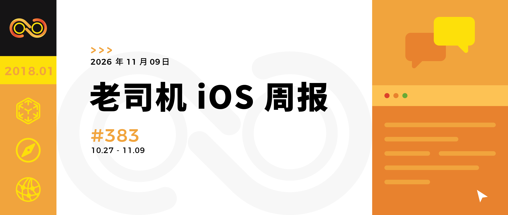

# 老司机 iOS 周报 #383 | 2026-11-09

老司机 iOS 周报，只为你呈现有价值的信息。

你也可以为这个项目出一份力，如果发现有价值的信息、文章、工具等可以到 [Issues](https://github.com/SwiftOldDriver/iOS-Weekly/issues) 里提给我们，我们会尽快处理。记得写上推荐的理由哦。有建议和意见也欢迎到 [Issues](https://github.com/SwiftOldDriver/iOS-Weekly/issues) 提出。

## 新闻

> 行业相关的新闻、趣事、看法

##  Developer - 设计开发加速器

> 设计开发加速器相关活动

## 新手推荐

> 收集一些对新手友好且质量不错的文章

## 文章

> 写的不错的技术博客，包含但不局限于 iOS、多端统一、设计、产品等

### 🐢 [Touch on Mac for Developers: 36 Points, Recognizers, Sidecar](https://blakecrosley.com/blog/touch-on-mac-for-developers)

[@Cooper Chen](https://github.com/cjlcooper)：这篇文章把 Mac 触控支持讲得很实际：不是推倒重写，而是一次有边界的排查。作者按迁移成本分层，帮开发者快速判断哪些代码不用动、哪些必须优先看:

- 标准 AppKit、SwiftUI 和 Catalyst 控件基本已经可用，真正的风险集中在自定义鼠标事件处理上。
- 直接触控只能通过 AppKit 手势识别器拿到；touchesBegan 一类方法只覆盖触控板和 Touch Bar，不会收到触控屏或 Sidecar 的直接触控。
- 设计上按 36 点触控目标来，扩大点击区域而不是控件本身；依赖 hover 的操作要留替代路径；自定义识别器必须处理 .cancelled。
- 触控 API 已在 macOS 27.0 SDK 中就位，但部分系统能力仍有缺失；眼下最现实的测试方式是用 Sidecar 连 iPad。

如果你维护着一个有些年头的 Mac App，担心触控带来隐性回归，这篇值得在动手前先读。它不制造焦虑，而是帮你圈出改动范围。

### 🐎 [Boost Your App’s Speed and Efficiency 29/10/26 - Q&A](https://antongubarenko.substack.com/p/boost-your-apps-speed-and-efficiency)

[@Smallfly](https://github.com/iostalks)：文章整理了 Apple 工程师围绕 App 性能、功耗和 SwiftUI 的问答，覆盖 SwiftUI specialist skill、`MetricKit`、State Reporting、`xctrace`、GPU 调试及第三方 SDK 性能评估。核心建议包括优先在真机和 Release 环境测量、要求编码代理先复现问题再验证修复，并结合性能数据与业务指标判断优化价值，适合建立团队性能排查和自动化验证流程。

### 🐕 [Retention Messaging in App Store Subscriptions](https://livsycode.com/best-practices/retention-messaging-in-app-store-subscriptions)

[@阿权](https://github.com/bqlin)：Retention Messaging（App Store 订阅挽留消息）是 WWDC26 推出，用户在 App Store 内发起取消自动续期订阅时，系统弹窗展示开发者自定义挽留图文 / 优惠，在用户真正完成取消操作前触达用户。分为静态后台配置、实时服务端 API 两套方案。

1. App Store Connect 静态配置
   - 零客户端、零后端开发成本；最多 10 条消息；单个订阅只能绑定 1 条消息。
   - 文案禁止写价格折扣数字；更新内容不需要发 App 版本。
   - 配套`Retention Offer`挽留优惠，由苹果校验用户资格。
2. Real‑Time API
   - 后端接收签名请求，由服务端决定展示什么，支持推荐同组其他订阅产品。
   - 硬性限制：700ms 响应超时；必须配置 App Store Connect 消息作为降级兜底；需要向苹果申请开通。
   - API 内使用`PromotionalOffer`，和 Retention Offer 是两套不同优惠。
3. StoreKit 事务变更 
   - Retention Offer 优惠在交易中标记 `offerType = 5`；实时 API 的促销优惠不会出现该值，后端解析交易务必兼容该枚举值，防止统计出错。
4. 数据指标陷阱
   - 挽救率统计包含关闭弹窗的无效行为，指标提升不等于长期留存、营收变好，要结合报表看后续续订与收入。
5. 选型建议
   - 简单业务直接使用 App Store Connect 静态配置，低成本验证效果。
   - 复杂用户分层、需要动态推荐套餐，再上实时 API，同时做好降级容错。

## 工具

> 开发过程中常用的工具，及一些新工具的介绍

## 代码

### 🐕 [Eiscue](https://github.com/LLLLLayer/Eiscue)

[@EyreFree](https://github.com/EyreFree)：Eiscue 是一套可在 iPhone 本地运行 AI Agent、摆脱 Mac 持续控制的实验性方案。传统 iOS 设备自动化大多依赖 Mac 通过 XCTest 远程驱动，而该项目提供两套可行路径：基于开发者服务的本机 VPN/USB‑NCM 方案，以及 ESP32 外设 HID 方案。它将 Agent 运行、屏幕采集、点击滑动输入能力集成到 iOS App 内，模型调用走云端 API，日常执行任务不再需要 Mac 常驻。方案覆盖配对认证、数据包回环、屏幕帧处理、坐标换算、剪贴板文本输入、后台任务恢复等完整链路，同时详细说明了开发者模式、DDI、系统权限等各类限制与边界条件，适合研究移动端本地智能体、iOS 自动化的开发者参考学习。感兴趣的同学可查看 [《一些脱离 Mac 依赖的 Agent 操作 iPhone 实现》](https://juejin.cn/post/7699051953464737801) 一文了解更多信息。

## 书

> 比较不错的书的推荐和书评

## 音视频

> 比较不错的书的推荐和书评

## 内推

重新开始更新「iOS 靠谱内推专题」，整理了最近明确在招人的岗位，供大家参考

具体信息请移步：https://www.yuque.com/iosalliance/article/bhutav 进行查看（如有招聘需求请联系 iTDriverr）

## 关注我们

我们是「老司机技术周报」，一个持续追求精品 iOS 内容的技术公众号，欢迎关注。

**关注有礼，关注【老司机技术周报】，回复「2024」，领取 2024 及往年内参**

同时也支持了 RSS 订阅：https://github.com/SwiftOldDriver/iOS-Weekly/releases.atom 。

## 说明

🚧 表示需某工具，🌟 表示编辑推荐

预计阅读时间：🐎 很快就能读完（1 - 10 mins）；🐕 中等 （10 - 20 mins）；🐢 慢（20+ mins）
